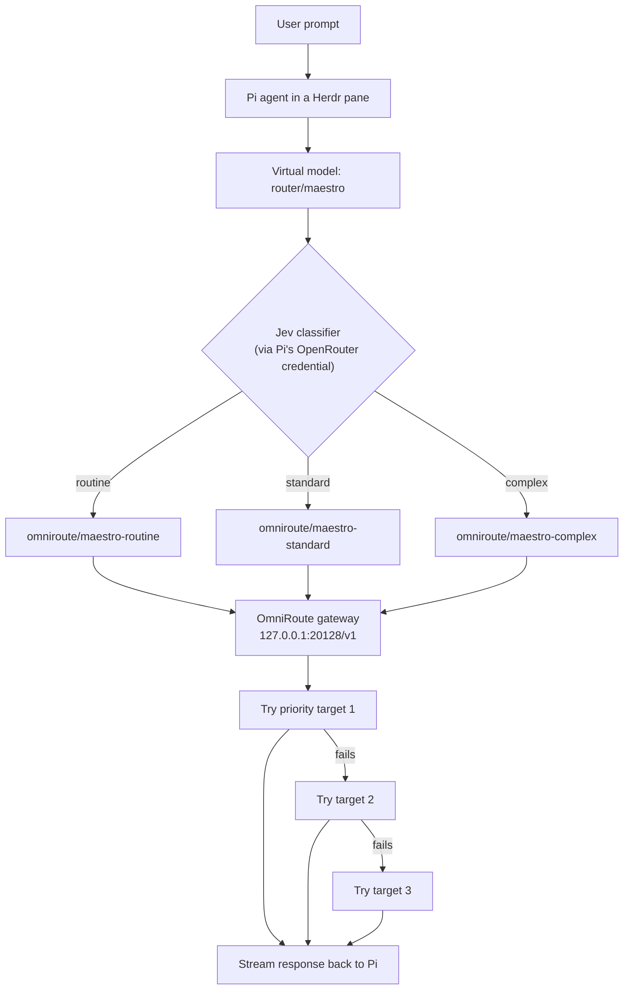

# One prompt, three tiers: how my Pi + Herdr + OmniRoute stack routes every turn

*Subtitle placeholder — e.g. "A tiny classifier picks the tier, and a local gateway picks the model."*

> **Note to self before publishing:** the diagrams below are Mermaid placeholders. Substack doesn't render Mermaid natively, so I'll swap these for images or a drawn diagram before posting.

**TL;DR** — I run the Pi coding agent inside Herdr. Every turn is first classified by a tiny model (Jev) into *routine*, *standard*, or *complex*. That classification only picks a **tier**. A separate local service, OmniRoute, turns the tier into an actual provider + model and owns all the failure fallback. The result: one selectable model name in Pi (`router/maestro`) that behaves like three different models depending on the task.

---

## 1. The pieces

Four things work together:

| Piece | Role |
|---|---|
| **Pi** | My coding agent. I select a single virtual model, `router/maestro`. |
| **Herdr** | A terminal workspace manager. Pi runs inside one of its panes, so I get tabs, panes, and agent lifecycle awareness. |
| **Maestro** | A Pi extension (a virtual model router). It classifies each new task into a tier. |
| **OmniRoute** | A self-hosted, OpenAI-compatible gateway on my machine. It executes the tier and handles provider/model fallback. |

The split of responsibility is the part I care about most: **Maestro decides *what kind* of work this is; OmniRoute decides *who does it*.** Maestro never talks to a model provider directly, and it never falls back to another tier on its own.

---

## 2. Pi + Herdr: the agent and its home

Pi is where I do the work. It has models, tools, sessions, compaction, and all the normal agent machinery. Herdr gives Pi a persistent terminal home — I can split panes, run background commands in sibling panes, and Herdr tracks whether the agent in a pane is idle, working, or blocked.

For model selection, Pi is pointed at a single virtual model:

```text
router/maestro
```

That name is registered by the Maestro extension. To me it looks like one model. Under the hood it's a routing layer that changes the *physical* model every turn based on the task.

The key idea: Pi also lets me set a **thinking level** (low / medium / high / xhigh). That level is an input to the router and passes through to whatever model finally answers.

---

## 3. OmniRoute topology

OmniRoute is a self-hosted gateway running locally in Docker. It speaks the OpenAI Chat Completions API at a loopback address, so Pi talks to it like any OpenAI-compatible endpoint.

```text
                     ┌─────────────────────────────────────────────┐
                     │                 My machine                 │
                     │                                             │
  Pi (in Herdr) ───► │  OmniRoute (Docker, 127.0.0.1:20128/v1)     │
                     │    │                                        │
                     │    ├─► provider: OpenCode Go                │
                     │    ├─► provider: OpenRouter                 │
                     │    └─► provider: Cloudflare Workers AI      │
                     └─────────────────────────────────────────────┘
```

What's important about this topology:

- **It's local and loopback-only.** Prompts go from my agent to my gateway to the provider; there's no hosted middle hop in between.
- **Auth is enforced.** The gateway requires an API key, and Pi reads that key at request time from a local file rather than hardcoding it in config.
- **Provider credentials live in OmniRoute**, encrypted at rest in its data directory. Pi doesn't know about them.
- **State persists.** Provider keys, combos, and the SQLite database survive container restarts.

The providers I've connected:

- **OpenCode Go** — my primary execution path for all three tiers (paid, API key).
- **OpenRouter** — my fallback path, and also where Jev classification runs (separately, see below).
- **Cloudflare Workers AI** — free-tier models used as additional fallbacks.

Inside OmniRoute I defined three **combos**, one per tier. A combo is an ordered list of target models plus a routing strategy. I use the `priority` strategy, which means: try target 1, and only on failure try target 2, then target 3.

---

## 4. Maestro-router: the dispatcher

The Maestro extension registers a Pi **virtual model**. The important part is what its `route()` function does on each request.

### 4.1 Classify the tier (once per new task)

For each new user message, Maestro sends the text to **Jev** — a tiny classification model from TypeSafe — and asks one question:

> How demanding is the software engineering work requested?

Jev returns a **choice** with probabilities across three labels: `routine`, `standard`, `complex`. Maestro maps that choice to a tier.

A few details worth noting:

- Jev is called through Pi's own OpenRouter credential, **not** through OmniRoute. Classification is cheap and separate from execution.
- If Jev is unreachable or unauthenticated, Maestro falls back to a keyword/length heuristic (e.g. words like "refactor" or "concurrency" push toward complex; "typo", "docs", "grep" push toward routine).
- Short approval replies ("continue", "go ahead") skip reclassification and keep the previous tier.

### 4.2 Map tier → OmniRoute combo

The tier maps to a named combo:

| Tier | Pi-side model name | OmniRoute combo |
|---|---|---|
| routine | `omniroute/maestro-routine` | ordered fallback list |
| standard | `omniroute/maestro-standard` | ordered fallback list |
| complex | `omniroute/maestro-complex` | ordered fallback list |

Maestro's job ends there. It hands the request to the combo and lets OmniRoute pick the actual provider/model.

### 4.3 Turn behavior

- **Routine** stays on the routine combo for the whole turn.
- **Complex** stays on the complex combo for the whole turn.
- **Standard** starts on the standard combo, but after the first successful file edit it hands the implementation tail to the routine combo, so the cheap model grinds through the rest.
- **Retries** stay on the same combo. This is deliberate: OmniRoute owns execution fallback, so Maestro doesn't compete with it by switching tiers on a failed request.
- **Compaction** and other out-of-loop work go to the routine combo.

If a combo is missing or has no configured auth, Maestro fails loudly instead of silently routing to a different tier. That keeps the layers honest.

---

## 5. Current tier map

This is my live configuration at the time of writing.

**Routine** — `maestro-routine`

1. `opencode-go/deepseek-v4-flash`
2. `openrouter/deepseek/deepseek-v4-flash`
3. `cloudflare-ai/@cf/qwen/qwen2.5-coder-32b-instruct`

**Standard** — `maestro-standard`

1. `opencode-go/deepseek-v4-pro`
2. `openrouter/openai/gpt-6-luna`
3. `cloudflare-ai/@cf/moonshotai/kimi-k2.6`

**Complex** — `maestro-complex`

1. `opencode-go/kimi-k3`
2. `openrouter/openai/gpt-6.1-sol`
3. `openrouter/anthropic/claude-opus-5.5`

---

## 6. How a request flows

*Placeholder visual — swap before publishing.*



Step by step:

1. I type a prompt in Pi (inside Herdr).
2. Maestro sees a new user message and asks Jev for a tier.
3. Maestro returns the matching OmniRoute combo as the physical model.
4. Pi sends a normal OpenAI-compatible chat request to OmniRoute.
5. OmniRoute walks the combo's priority list, trying each target until one succeeds.
6. The winning provider streams the answer back through OmniRoute to Pi.

---

## 7. Reasoning level passes straight through

The thinking level I pick in Pi flows through both layers untouched:

- Maestro returns the selected level unchanged (no per-tier remap).
- Pi sends it as `reasoning_effort` on the OpenAI-compatible request.
- OmniRoute runs in "passthrough" mode for thinking, so it doesn't strip or rewrite the value.
- OmniRoute then translates the effort into whatever the winning provider natively expects (Claude's thinking budget, Gemini's thinking config, OpenRouter's reasoning object, etc.).

I also map `xhigh` explicitly on the Pi side so it isn't silently clamped down to `high`.

---

## 8. What I like about this setup

- **One model name, three behaviors.** I don't switch models manually; the task does it.
- **Layered fallback.** Maestro owns *classification*, OmniRoute owns *execution failover*. They don't step on each other.
- **Provider-agnostic tiers.** I can reorder a combo or swap a provider without touching the classifier.
- **Local and observable.** Everything runs on my machine, and OmniRoute logs which target it tried and why.

## What I'd still tune

- OpenRouter targets are currently explicit fallbacks, so they can still be hit (and billed) when an earlier target fails.
- The combos advertise context limits from their largest target, which can overpromise relative to a smaller fallback model.
- Cost is tracked in OmniRoute, not asserted from Pi's catalog metadata.

---

*End of draft — swap Mermaid blocks for real visuals before publishing.*
